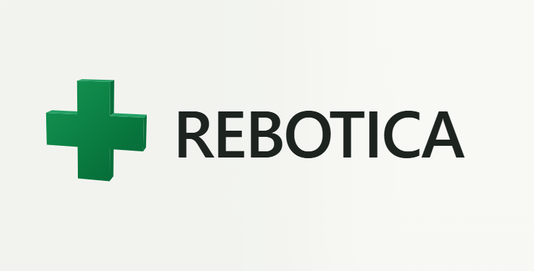
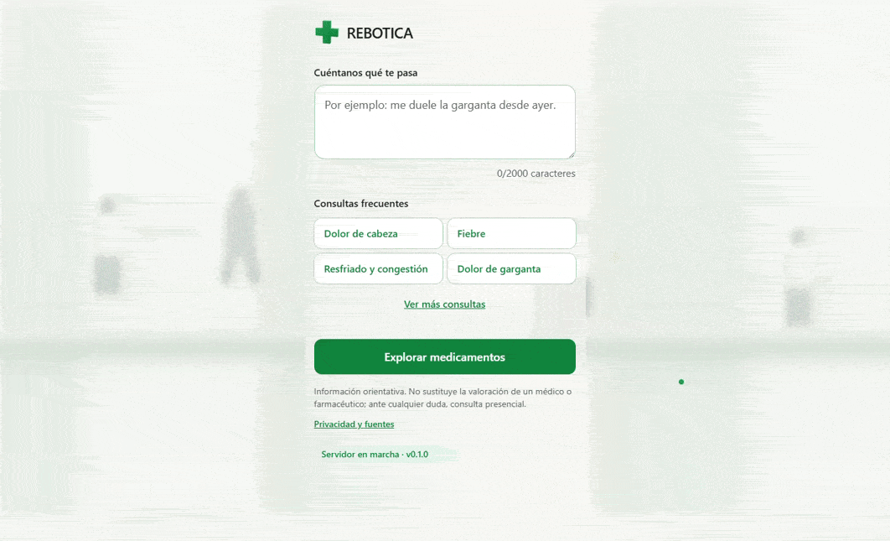
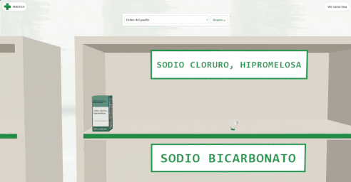

# Rebotica 3D

Explora medicamentos por dolencia en un pasillo 3D o en una lista. Consulta sus fichas y
prospectos oficiales de CIMA (AEMPS), con los productos sin receta y con receta en zonas separadas.

La IA interpreta la consulta y detecta alarmas; no elige medicamentos ni dosis. La calculadora
solo está disponible cuando existe una regla validada y vigente. No se guarda el texto de las
consultas ni los datos de la calculadora.

> Información orientativa. No sustituye la valoración de un médico o farmacéutico.

[Abre la aplicación](https://rebotica.martinezpastor.dev)

## Así funciona

**Vista de lista y comparativa.** Consulta las fichas y compara dos medicamentos en una misma vista.



**Estanterías 3D.** Recorre el pasillo virtual y selecciona un medicamento para ver su ficha.



## Arranque local

Requiere **Node.js 22.12 o superior** y **pnpm 10**.

```bash
pnpm install
pnpm catalogo
```

Abre [localhost:5173](http://localhost:5173). El catálogo se descarga en `.local/catalogo/`,
sin necesitar PostgreSQL externo, y conserva el progreso entre reinicios.
**Los resultados son parciales hasta completar la primera carga**, que puede durar horas.

Las consultas frecuentes funcionan sin Gemini. Para interpretar texto libre, configura Gemini
siguiendo la [guía de interpretación](apps/api/INTERPRETACION.md).

## Comandos útiles

| Comando          | Uso                                           |
| ---------------- | --------------------------------------------- |
| `pnpm dev`       | Desarrollo: web en :5173 y API en :3000       |
| `pnpm demo`      | Probar con una muestra pequeña en memoria     |
| `pnpm cobertura` | Consultar el estado y cobertura del catálogo  |
| `pnpm check`     | Comprobar formato, lint, tipos, tests y build |

## Documentación

- [Hoja de ruta](HOJA_RUTA.md)
- [Privacidad y fuentes](docs/PRIVACIDAD.md)
- [Cobertura del catálogo](docs/COBERTURA.md)
- [Revisión farmacéutica](docs/REVISION_CLINICA.md)
- [Instrucciones para desarrollo](AGENTS.md)

## Licencia

Este proyecto se distribuye bajo la [licencia MIT](LICENSE).
